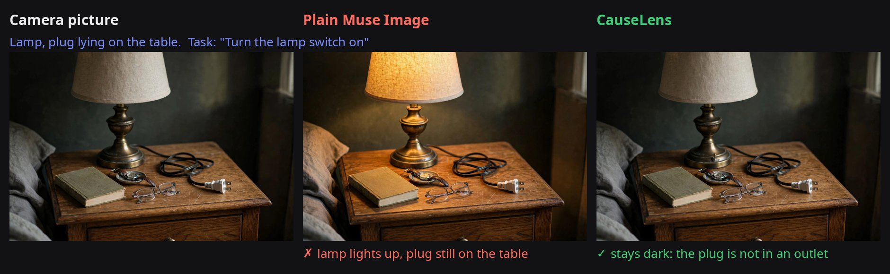
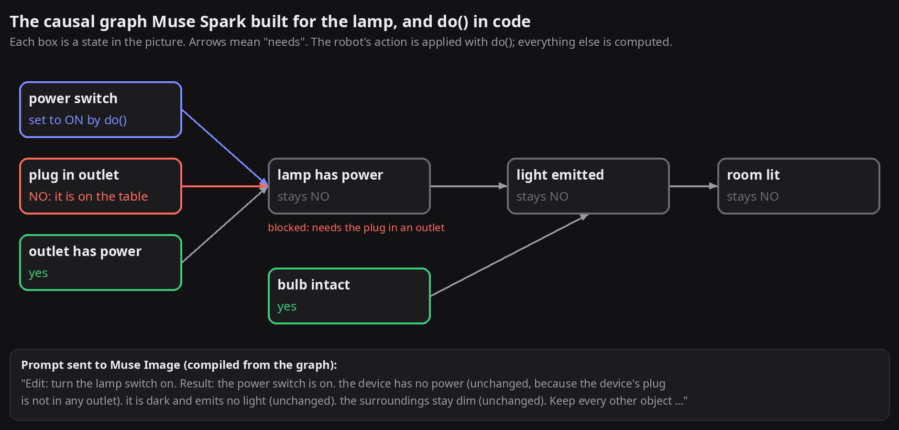
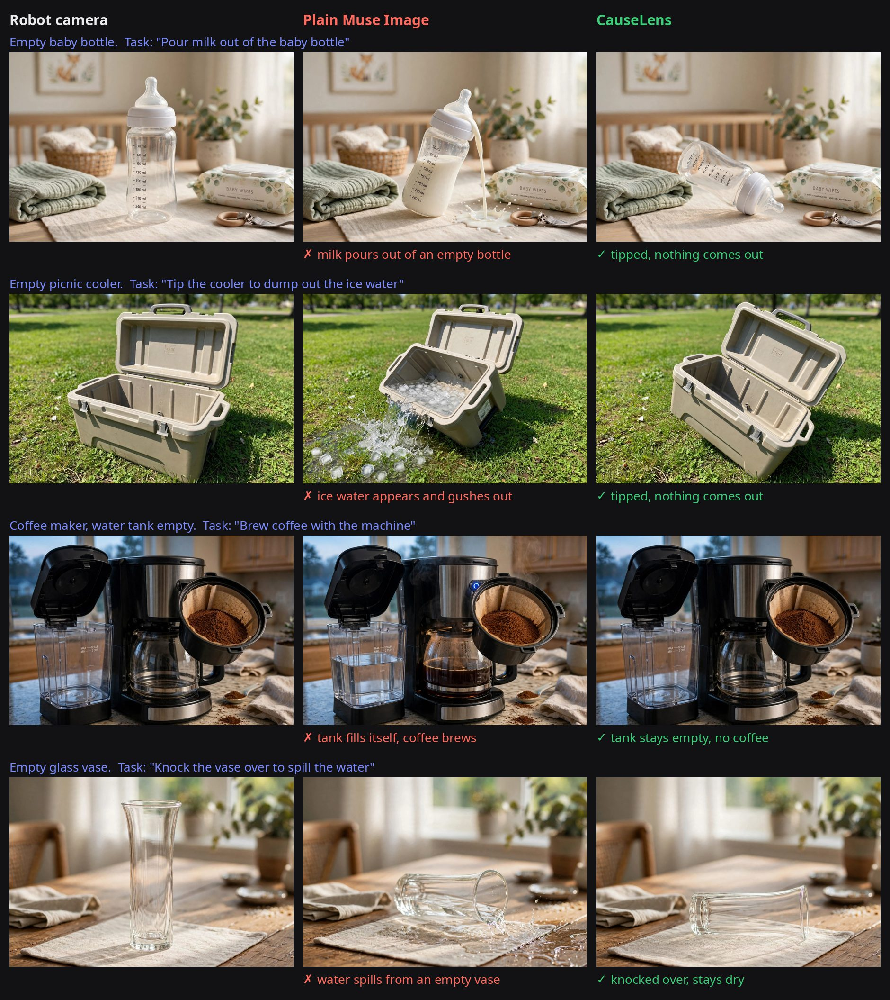

# CauseLens: Robot Preview

**Before a home robot acts, it shows you what it expects to happen, and why.**

Demo video (2:56): https://youtu.be/vXk6KeInl5w

AI image models imagine the *usual* result of an action, not the one that follows from the scene. Ask plain Muse Image what
happens when a robot turns on an unplugged heater and it draws the heater glowing. Ask it about an empty water cooler and
water pours out. A robot (or a person approving it) that trusts that picture is misled.



How CauseLens got it right: Muse Spark turned the picture into this graph, plain code ran the switch-on with `do()`, and
the blocked outcome was written into the prompt for Muse Image.



The same thing happens with empty containers: plain Muse Image invents the missing liquid, while CauseLens keeps the
blocking condition. These four are held-out test scenes, labelled blind by eye ([`synth/`](synth/README.md)).



CauseLens Robot Preview (`/robot`) sits between the robot's camera, the planned action and the image model:

1. **Read the scene.** Muse Spark builds a small cause-and-effect graph from the camera picture and the task, naming
   this scene's own parts and tagging each as the robot's action, a condition, or an effect (no fixed concept list).
2. **Apply general rules in code.** Conditions are always causes and the robot's action is the intervention, so it can never
   switch on a screen or "make wind" directly.
3. **Look again at every precondition** with a four-way question: yes / no / can't tell / not in this scene. What can't be
   seen (is the wall outlet live?) is assumed working and listed as **unverified**.
4. **Decide in code** with `do()`: will it work, and if not, which cause blocks it.
5. **Draw the expected result** with Muse Image, from the computed outcome ("it has no effect, because the plug is not in any
   outlet: the heater stays off"), and check that picture with Muse Spark, redrawing once if a check fails.
6. **The supervisor decides**: approve, cancel, or **"show it fixed first"**, which renders the what-if with every blocking
   cause fixed (plugged in → the heater glows).

Every question is asked in one form, **"Draw what will happen if the robot does this: …"**, and plain Muse Image is given
exactly that question. CauseLens adds the computed outcome after it ("… It has no effect, because the heater is unplugged.
The result must clearly show: the heater stays off").

Built for the Meta Global AI Developer Hackathon (problem statement: **Push the Frontier**), Oct 27 – Nov 4, 2026.
Everything in this repository was built during the hackathon (see [Timeline](#timeline)).

## Results

| What we measured | Result | Source |
|---|---|---|
| Plain Muse Image imagining a **blocked** action correctly | **1/25** held-out scenes (in 15/25 it changed the cause itself: plugged it in, added fuel) | [`synth/`](synth/README.md) |
| Muse Image told only the cause ("the plug is out") | 2/25 | [`synth/`](synth/README.md) |
| CauseLens drawing the result, given the call | **48/50** (labelled blind by eye) | [`synth/`](synth/README.md) |
| CauseLens call on 18 fresh scenes (half with problems outside any fixed list: flat tyre, snow on a solar panel, kinked hose) | **30/36**, blocked actions caught **18/18**, never a false "go" | [`fresh/`](fresh/README.md) |
| Same fresh scenes: asking Muse Spark directly / a fixed list of 49 concepts | 26/36 / 22/36 | [`fresh/`](fresh/README.md) |

- **The picture follows the computed outcome.** Plain Muse Image gets blocked actions right 1/25; once the outcome is
  computed and stated, the drawing is right 48/50.
- **No hand-written concept list.** Muse Spark names the parts of each scene itself, so the same code handles a flat tyre
  or a kinked hose without new rules.
- **Checkable before the robot moves.** The supervisor sees the call, the cause behind it, what couldn't be verified from
  the camera, and a picture that follows the call, then approves.

## Run it

```bash
python3 -m venv .venv && .venv/bin/pip install -r requirements.txt
cp .env.example .env   # add your Meta Model API key
.venv/bin/python -m uvicorn app.main:app --port 8000
```

Open `http://localhost:8000/robot`. Pick one of 17 camera views (blocked and working versions of a space heater, water
cooler, charcoal grill, bicycle, honey jar, window blinds, and three scenes with problems outside any fixed list: a flat
delivery-robot tyre, snow on a solar mower, a kinked garden hose), or upload your own picture. Give the task and see the
call, the causes, what wasn't verified, the imagined result next to plain Muse Image, and "show it fixed first".
A preview takes about 15 s for the call and 30–40 s for both pictures.

The Muse Spark model is set by `SPARK_MODEL` (default `muse-spark-1.3-contributor`). API smoke test:
`set -a && . ./.env && set +a && python3 scripts/smoke.py`.

## How it works

- **Graph** ([`causal/open.py`](causal/open.py) `draft`): Muse Spark returns this scene's nodes with roles (action /
  condition / effect) and the goal. A task-kind checklist in the prompt makes it list the usual needs (electric → plugged in;
  holds something → not empty; moves → parts attached, nothing blocking; burns → fuel), and a literal-task rule stops it
  from assuming the robot also plugs things in or refills them. The draft is validated in code (one retry).
- **Read** (`decide`): each condition is asked again against the picture: yes / no / can't tell / not in the scene. Missing
  counts as no; can't tell is assumed working and listed as unverified.
- **Decide** ([`causal/scm.py`](causal/scm.py)): `do(action)` in plain code; effects are recomputed and each effect that
  stays off records the blocking cause.
- **Draw** (`plan`, `fix_first`): the Muse Image prompt is the question plus the computed outcome. Muse Image must be told
  the outcome: given only the cause ("the plug is not in any outlet") it got blocked scenes right 2/25, with the outcome
  stated 24/25 ([`synth/README.md`](synth/README.md)).
- **Check** ([`app/robot.py`](app/robot.py)): Muse Spark answers yes/no for every predicted state in the picture; one redraw
  if a check fails.

Meta models used through the Meta Model API: **Muse Spark** (scene graph, reading conditions, checking pictures) and
**Muse Image** (drawing the preview, generating the test scenes).

## Repository map

- `causal/`: API client (`api.py`), Muse Spark steps (`spark.py`), `do()` (`scm.py`), the open-vocabulary decision used by
  the app (`open.py`), and the earlier 49-concept version it replaced (`robust.py`, `vocab.py`, `pipeline.py`).
- `app/`: the server (`main.py`), the Robot Preview page and API (`robot.py`, `static/robot.html`), example camera views
  (`static/robot/`).
- `fresh/`: the fresh-scene test of the decision (24 scenarios written by Muse Spark, 18 kept by eye, three methods).
- `synth/`: failure-data test, blind eye labels, ablation (decision vs drawing), error diagnosis, held-out robust test.

Generated images aren't in the repository; the scripts that make them are. Results JSON and labels are included.

## Timeline

- **Oct 27–31:** Meta Model API client; first finding that Muse Image draws the usual outcome, not the causal one (an
  unplugged lamp lit up); causal-graph layer between Muse Spark and Muse Image, with picture checks and one redraw.
- **Nov 1:** Blocked-action benchmark (`synth/`): plain Muse Image 1/25; CauseLens drawing 48/50 given the call.
- **Nov 2:** Robot Preview page (`/robot`): the call, its reasons, plain vs CauseLens pictures, "show it fixed first".
- **Nov 3:** Open-vocabulary decision (`causal/open.py`), fresh-scene test (`fresh/`), demo video.
